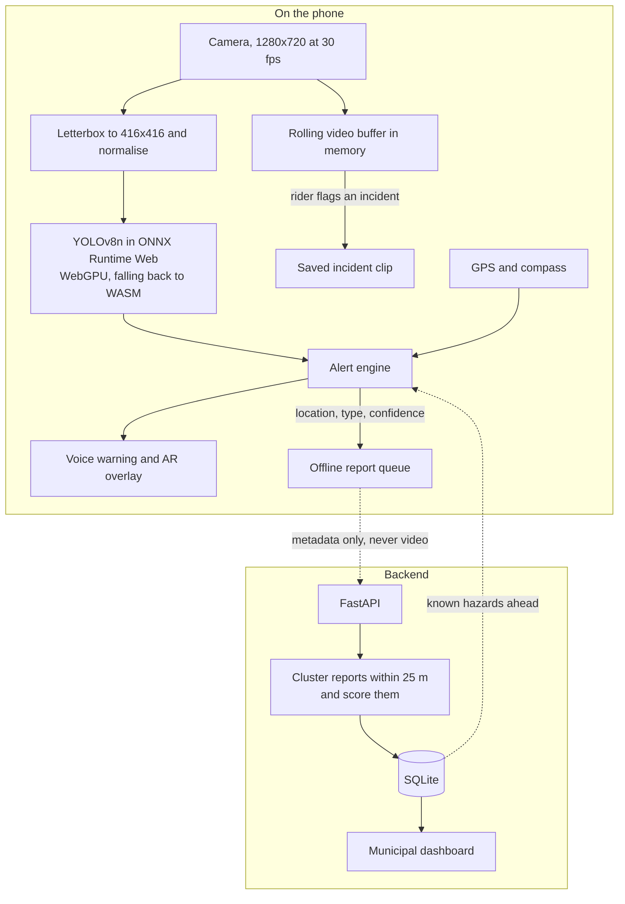
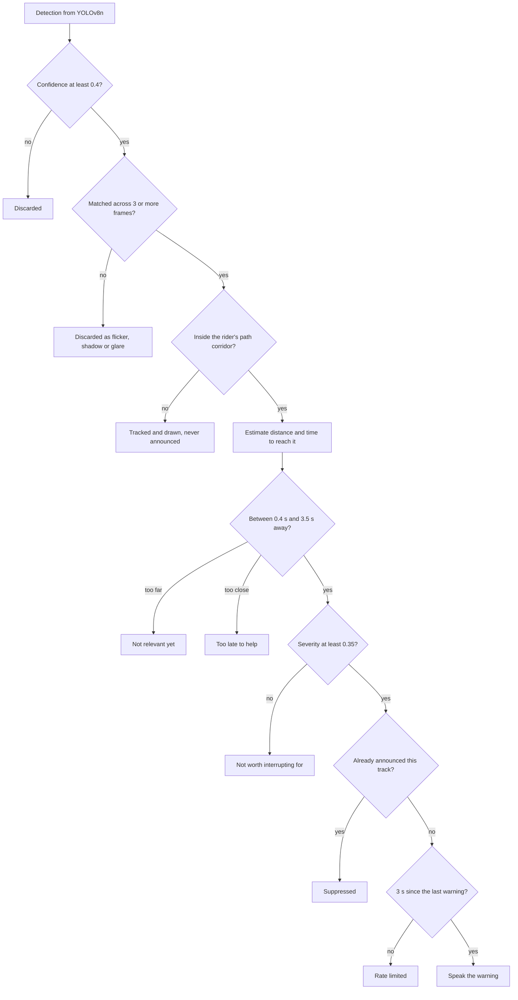
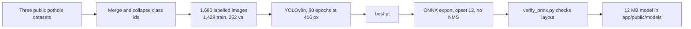
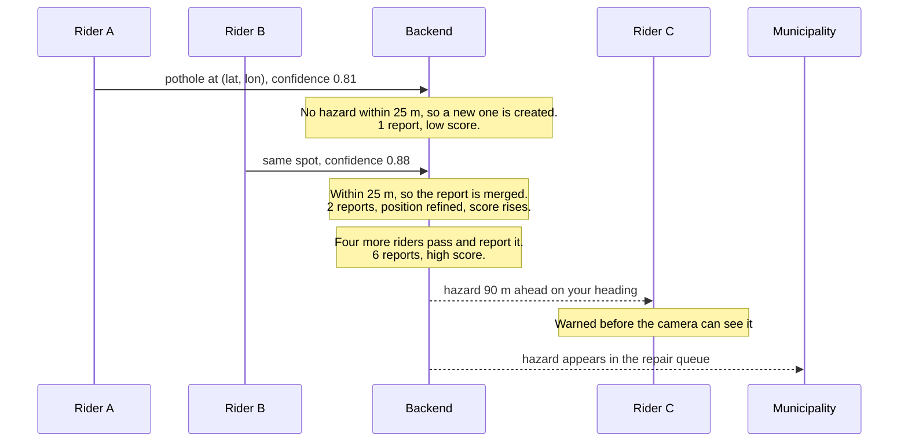
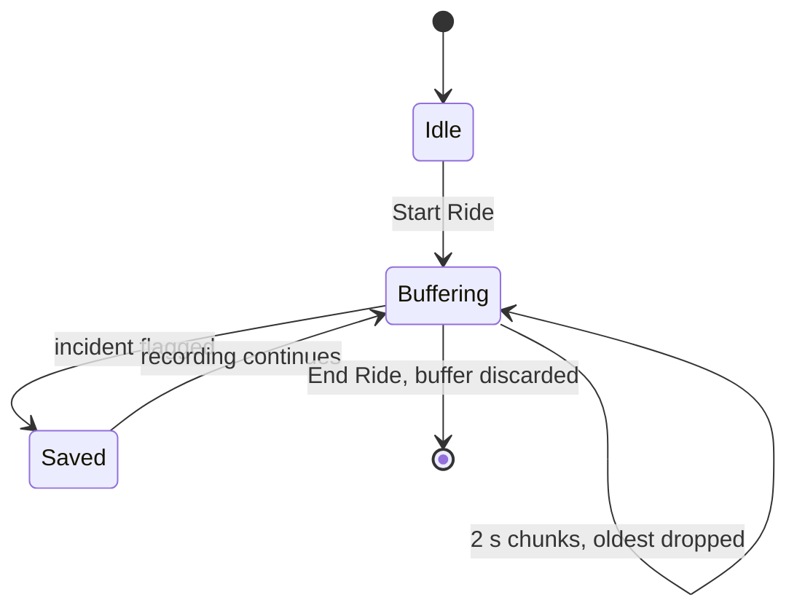
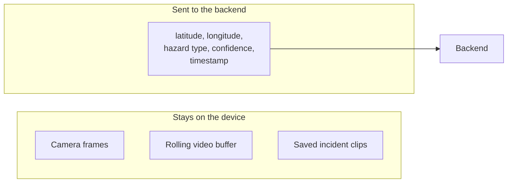
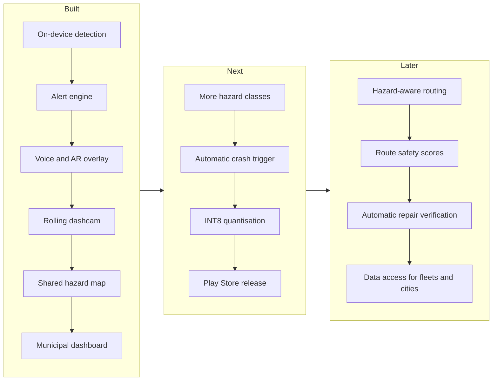

# PathFinder AR

PathFinder AR is a driver-assistance system for two-wheelers that runs entirely on a phone mounted to the handlebar. It watches the road through the phone camera, warns the rider by voice when a hazard is coming up in their path, keeps a rolling dashcam buffer that is only saved when the rider asks for it, and contributes anonymous hazard locations to a shared map that other riders and city maintenance teams can use. Detection happens on the device, so the safety features keep working without a network connection and no video ever leaves the phone.

The project is made of three parts that live in this repository: a small YOLOv8n model trained to find potholes, a TypeScript progressive web app that runs that model in the browser and decides when to speak, and a FastAPI backend that merges reports from many riders into a single map with a confidence score for each hazard.

## Why this exists

Cars in the mid-price range now come with collision warnings, lane assistance and built-in cameras. Motorcycles and scooters, which make up more than 70% of registered motor vehicles in India, get none of this, even though a two-wheeler rider is the road user most exposed to a bad surface. A pothole that a car rolls over can put a scooter on the ground.

Most of these incidents come down to timing rather than visibility. At 40 km/h a bike covers about 11 metres every second. If a rider notices a water-filled pothole 8 metres ahead, they have roughly 0.7 seconds to respond, which is less than typical reaction time plus braking distance. The hazard was visible the whole time; the rider simply noticed it too late. A phone camera pointed at the road can notice it earlier, and that small lead is what this project tries to give back to the rider.

## How the system fits together

The phone does all of the time-critical work. The camera feed is resized and passed to the detector, the detector's output goes through the alert engine, and the alert engine decides whether to say anything. In parallel the camera stream feeds a dashcam buffer held in memory. GPS and compass readings are used both to estimate speed for the alert engine and to tag hazards before they are queued for upload.

The backend is optional from the rider's point of view. When it is reachable, the phone sends it small reports containing a location, a hazard type and a confidence value, and in return it receives hazards already known further along the road. When it is not reachable, reports wait in a local queue and are sent later.



## Getting it running on a phone

The app is built once and then served by the backend, so the rider app, the API and the dashboard all live on the same origin and port. A Cloudflare quick tunnel then gives that port a public HTTPS address.

```bash
pip install -r server/requirements.txt
python server/seed_demo.py                            # optional, fills the map with demo data

cd app && npm install && npm run build && cd ..
uvicorn server.main:app --port 8000
cloudflared tunnel --url http://127.0.0.1:8000
```

Open the URL that `cloudflared` prints on the phone, allow camera and location access, and tap Start Ride. The municipal dashboard is at the same address with `/dashboard` appended.

The phone does not have to share a network with the laptop. The tunnel connects outward to Cloudflare, so there is no port forwarding or public IP involved, and the phone can be on mobile data. The tunnel also provides HTTPS, which matters because browsers will not grant camera access to an insecure page.

The first visit downloads about 38 MB: the 12 MB model and the 25 MB WebAssembly runtime. It is worth doing this once on wifi. After that the service worker has everything cached, and because inference happens on the device, detection and the dashcam continue to work with no signal. Only the shared map pauses, and anything queued is sent once the connection returns.

Quick tunnels are meant for testing. The laptop has to stay awake and the hostname changes every time the tunnel restarts. For a permanent setup, deploy `app/dist` to a static host and run the backend anywhere Python is available.

For day-to-day development, `npm run dev` inside `app/` starts Vite with hot reload on a LAN address using a self-signed certificate. A phone on the same wifi can reach it after accepting the certificate warning. This is convenient for UI work, but the build-and-tunnel route above is the one to use for real rides. Detailed phone setup and the Play Store packaging steps are in [android/README.md](android/README.md).

## The alert engine

Running a pothole detector on road video is straightforward. Making the output useful to someone on a moving bike is where most of the work is. A raw detector fires on shadows, tar patches, manhole covers, wet asphalt and drain grates many times per kilometre, and a rider who hears a false warning every few seconds will stop listening within one commute. A warning system that is ignored is worse than none at all, because it takes attention and gives nothing back.

The alert engine in [app/src/hazards.ts](app/src/hazards.ts) exists to throw most detections away. It is plain arithmetic with no browser dependencies, which makes it easy to test (see [app/src/hazards.check.ts](app/src/hazards.check.ts)) and easy to port. Each detection passes through a series of checks, and only one that survives all of them is spoken aloud.



The first filter is the detector's own confidence. Anything below 0.4 is not considered at all.

The second filter is persistence over time. Detections are matched to existing tracks by class and bounding-box overlap, and a track has to be seen in at least three frames before it can raise a warning. A shadow or a patch of glare rarely survives three frames from a moving camera in the way a real pothole does, so this step removes most false positives on its own. Tracks that go unmatched for more than five frames are dropped.

The third filter asks whether the hazard is actually in the rider's way. The engine projects a corridor in front of the bike that is narrow at the horizon and widens toward the bottom of the frame, following perspective. A pothole at the kerb is still detected, tracked and drawn on screen, but it is never announced. The AR overlay draws this corridor using the same function the engine tests against, so the lines the rider sees on screen are exactly the ones that decide what counts as in the path.

Next the engine estimates how far away the hazard is and, using the current GPS speed, how many seconds until the bike reaches it. If there is no GPS fix yet it assumes about 29 km/h. A warning is only considered when the hazard is between 0.4 and 3.5 seconds away. Further than that, it is too early to matter; closer than that, there is nothing useful the rider can do with the information.

Severity then combines the hazard type, the detector's confidence and the urgency implied by the time remaining. Anything below 0.35 is recorded but not spoken. Finally, each track is only ever announced once, and the engine waits at least three seconds between any two warnings so that a stretch of bad road does not turn into a stream of noise. What remains is spoken in a short form such as "pothole ahead, 20 metres", because a rider should be looking at the road, and the screen only confirms what the voice has already said.

## Measuring distance with one camera

A phone has no depth sensor, radar or second camera to work with. It does not need them, because a road is close enough to flat for a simple geometric model to work. If the road is a plane and the camera sits at a known height, then the position of the bottom edge of a bounding box in the frame determines how far away the object is. Something touching the horizon line is effectively infinitely far away; something at the bottom edge of the frame is right in front of the wheel.

```
        camera
          |\
   height |  \   angle below the horizon
     (h)  |    \
          |      \
   =======+========\=================== road
          |<--- d --->|

                 d = h / tan(angle)
```

The angle comes directly from how far below the horizon line the bottom of the box sits, scaled by the camera's vertical field of view. Combined with speed, this gives the time to reach the hazard, which is what the warning decision actually depends on. Thirty metres is urgent at 60 km/h and irrelevant when the bike is being walked.

The result is only as good as the camera geometry it is given, and that varies a lot between bikes. A phone on a scooter sits at a different height and angle from one on a sports bike, and the estimated distance scales directly with camera height. For that reason the geometry is exposed as settings in the app rather than hard-coded. The defaults are a camera height of 1.0 m, a horizon at 45% of the way down the frame, a 55 degree vertical field of view, and a warning window of 3.5 seconds.

Calibrating takes about a minute with the phone in its mount. Measure the height from the lens to the road with a tape, since distance depends on it linearly and a guess is usually off by enough to matter. Then look at the camera view and adjust the horizon setting until the green corridor lines sit on the edges of your lane.

## Training the model

The detector is YOLOv8n fine-tuned on three public pothole datasets from the Hugging Face Hub. The preparation script downloads them, maps every source class to a single "pothole" class (the sources use inconsistent class ids), and splits the combined set into 1,428 training and 252 validation images. Training runs for 80 epochs at 416 pixels and takes about ten minutes on an RTX 4060. The best checkpoint is exported to ONNX with opset 12 and without built-in non-maximum suppression, because the app runs its own suppression in TypeScript. A separate script then checks that the exported tensor layout is what the app's decoder expects.



```bash
python ml/prepare_data.py    # download, merge and split the datasets
python ml/train.py           # train and export to app/public/models/
python ml/verify_onnx.py     # confirm the export matches the app's decoder
```

The best checkpoint, from epoch 79, reaches a mAP@50 of 0.796 and a mAP@50-95 of 0.470, with precision of 0.828 and recall of 0.733. The model file is 12 MB and runs at around 5 frames per second on a mid-range Android phone using WebGPU.

These numbers are good for a small model but not good enough to act on directly. A precision of 0.83 means roughly one raw detection in six is wrong, which on a real ride works out to several false positives a minute. That is the reason the alert engine carries so much of the system's weight. The lower mAP@50-95 matters less than it looks, because the distance estimate only depends on the bottom edge of the box.

Augmentation is chosen for the conditions that actually degrade detection from a bike: low light, colour shifts, small rotations and changes in scale. Images are flipped horizontally but never vertically, since roads do not appear upside down. A larger model such as YOLOv8s would score higher but runs at about 2 frames per second on the same phone, which at 40 km/h means more than five metres of travel between frames. On a moving vehicle, latency is part of accuracy.

## The shared hazard map

A single detection from one phone is weak evidence. The same hazard reported independently by several riders at the same spot is much stronger, and the backend in [server/main.py](server/main.py) is responsible for turning the first into the second.

The phone is conservative about what it sends. A hazard is only reported after it has passed the alert engine and triggered a warning, and only if the detector's confidence was at least 0.55, because false positives on a shared map mislead every rider who uses it.

When a report arrives, the server looks for an existing hazard of the same type within 25 metres. If it finds one, the report is merged into it: the report count goes up, the average confidence is updated, and the hazard's position moves slightly toward the new sighting so that repeated reports sharpen the location. If nothing matches, a new hazard is created.



Each hazard carries a score that combines how many reports it has, how confident those reports were, and how recently it was last seen:

```
score = min(1, mean_confidence * (1 - 0.55^reports) * 1.25) * 0.5^(age_days / 45)
```

The corroboration term rises quickly and then levels off, because the difference between one and six reports matters a great deal while the difference between six and sixty does not. The age term halves the score every 45 days without a new sighting, so a road that has been repaired stops producing warnings without anyone having to report the repair. And because the detector's own confidence feeds into the score, a series of hesitant detections cannot produce a confident marker.

On the phone, hazards from the map are only announced when they lie within 40 degrees of the rider's current heading. This means the rider hears about the pothole around the next corner, not the one they have already passed.

The same data drives the dashboard at `/dashboard`, which gives a city maintenance team a map of reported damage ranked by confidence, along with totals by hazard type.

## Dashcam

The dashcam in [app/src/dashcam.ts](app/src/dashcam.ts) records the camera stream in two-second chunks and keeps the most recent three minutes in memory, discarding the oldest chunk as each new one arrives. Nothing is written to storage during a normal ride. When the rider flags an incident, either with the button or a double tap, the current buffer is frozen into a local video file tagged with the current location. Saved clips are never uploaded automatically.



This keeps storage use flat and means that an uneventful ride leaves no footage behind at all. A dedicated motorcycle dashcam is expensive and easy to steal from a parked bike; this uses the phone the rider already has.

## Privacy

The privacy guarantees here come from how the code is structured rather than from a policy. There is no code path anywhere in this repository that uploads video, frames, or the model's inputs. Camera frames are processed in memory and discarded, and the only thing that crosses the network is a hazard report containing a latitude, a longitude, a hazard type, a confidence value and a timestamp.



Reports carry no account, device identifier or session identifier, so individual reports cannot be linked to each other or to a person. Sharing can be switched off in the app's settings, and doing so has no effect on warnings or the dashcam, since neither of them depends on the network.

## Technology choices

The app is a plain TypeScript PWA built with Vite and no UI framework. Modern mobile browsers expose everything the safety loop needs, including the camera, GPS, compass, speech synthesis, `MediaRecorder` and GPU compute, and a PWA can be installed straight from a URL. A framework such as React or Flutter would add tooling without giving the app anything it currently lacks.

Inference uses ONNX Runtime Web with the WebGPU backend where it is available and WebAssembly everywhere else. The same model file serves both, and WebGPU is several times faster on recent Android devices.

Maps use Leaflet with OpenStreetMap tiles, and navigation uses the public Nominatim and OSRM services. None of these need API keys or billing, which keeps the project runnable by anyone. The public endpoints are rate limited and are fine for a prototype but not for production use.

The backend is a single FastAPI file backed by SQLite. Spatial lookups narrow candidates with a bounding box and then compute exact distances with the haversine formula, which is accurate enough at city scale and avoids the need for a spatial database. Moving to PostGIS would make sense if the dataset grew well beyond a single city.

For distribution, the PWA can be wrapped as a Trusted Web Activity, Google's supported mechanism for publishing a web app on the Play Store with full camera and location access. The steps are in [android/README.md](android/README.md). The one thing a web app cannot do is keep recording with the screen off; if that becomes a requirement it would be the reason to build a native app. The alert engine has no dependencies and would port easily, and the training script can export TFLite instead of ONNX by changing the export format.

## Repository layout

```
ml/
  prepare_data.py       download and merge the pothole datasets into YOLO format
  train.py              fine-tune YOLOv8n and export ONNX into the app
  verify_onnx.py        check the exported tensor layout against the app's decoder

app/
  src/detector.ts       ONNX session, letterboxing, YOLO output decoding, NMS
  src/hazards.ts        alert engine: tracking, distance, path corridor, severity
  src/hazards.check.ts  runnable assertions for the alert engine
  src/geo.ts            GPS, compass, offline report queue, hazard map client
  src/nav.ts            geocoding and routing
  src/dashcam.ts        rolling in-memory video buffer
  src/alerts.ts         chime and speech synthesis
  src/main.ts           app wiring, AR rendering and UI
  public/sw.js          service worker for offline caching

server/
  main.py               report clustering, consensus scoring and API
  dashboard.html        municipal repair-priority dashboard
  seed_demo.py          generates demo hazard data
  test_server.py        runnable assertions for the backend

android/README.md       phone testing and Play Store packaging
```

## Checks

There is no test framework. Each part of the system has a small script of assertions that can be run with one command.

```bash
cd app && npm run check        # alert engine: persistence, path corridor, severity, suppression
python server/test_server.py   # clustering radius, scoring, decay, filters
python ml/verify_onnx.py       # ONNX output layout matches the TypeScript decoder
```

The ONNX check is there because a change in the model's output layout would not cause an error. The app would simply draw boxes in the wrong places, which is not something you want to discover while riding.

## Known limitations

The model only recognises potholes. The severity model already has weights for speed breakers, water-filled potholes, waterlogging and debris, but there is no training data for them yet. Adding them needs labelled data and no code changes, since the pipeline does not assume a particular set of classes.

Distance estimation assumes a flat road, so it tends to be optimistic on hills and crests. Using the accelerometer to estimate pitch would correct for this.

At around 5 frames per second on mid-range hardware, a bike at 40 km/h moves about two metres between frames. INT8 quantisation, or a native build using NNAPI or Core ML, would help here.

Incidents are flagged manually. The accelerometer is already available to the app for the compass, so an automatic crash trigger would be a small addition.

The report endpoint has no authentication or rate limiting and trusts whatever it receives. That is acceptable for a prototype but would need device attestation or a similar measure before any real deployment.

Continuous camera use and inference draw a lot of power and generate heat, particularly in hot weather. Reducing the inference rate when the bike is slow or stationary is the obvious next step.

The app is not yet on the Play Store, although the packaging steps are documented and ready.

## Where it could go next

The core loop is in place: on-device detection, the alert engine, voice and AR output, the dashcam, the shared map and the dashboard. The near-term work is adding more hazard classes, wiring an automatic crash trigger, quantising the model, and submitting to the Play Store.



Further out, the hazard data becomes useful beyond the app itself. Routing could avoid badly damaged roads, routes could be given a safety score, and the decay built into the scoring model could confirm repairs automatically when riders stop reporting a hazard. Municipalities could use the map in place of manual road surveys, delivery fleets could route riders around damage, and insurers could use it as evidence of road conditions. None of this requires the rider to pay anything; the rider contributes data and gets earlier warnings in return.
