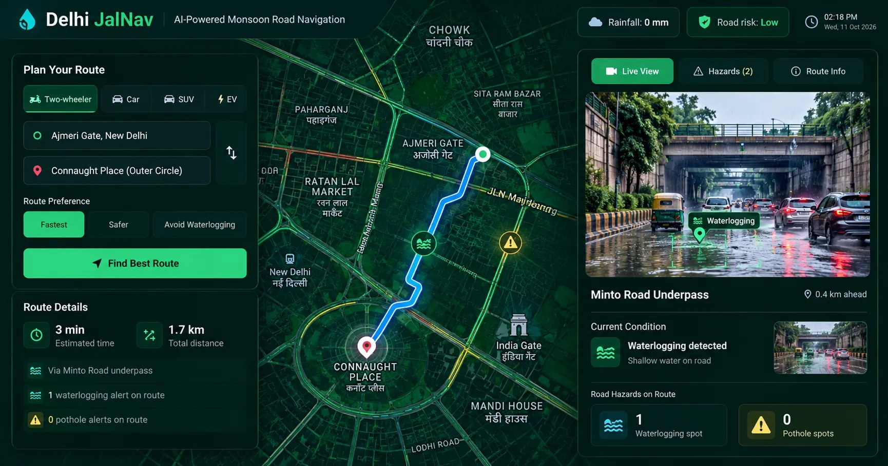
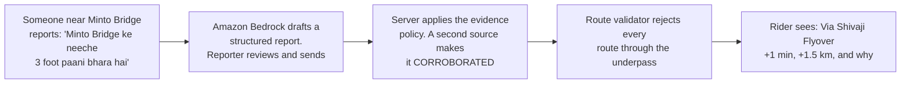
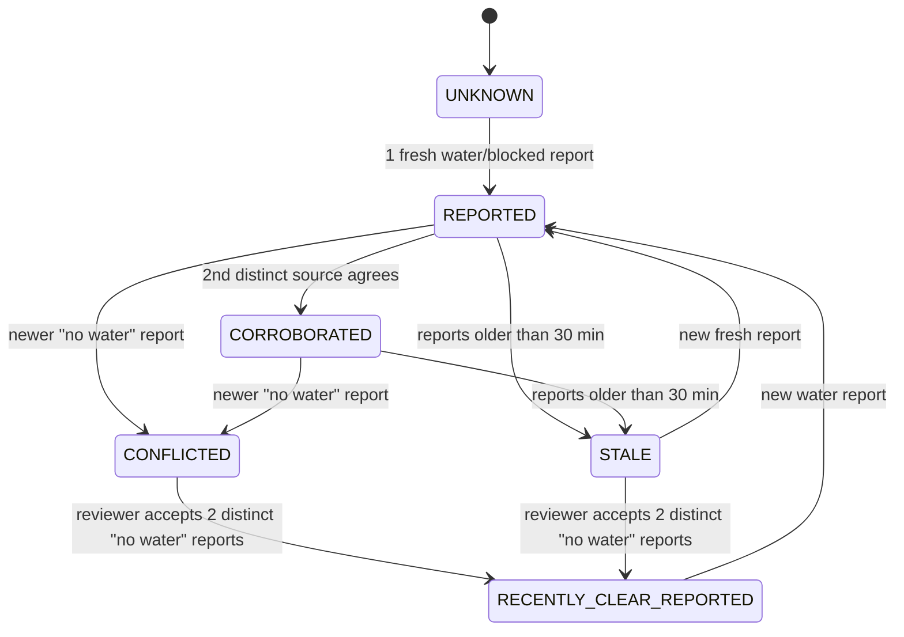
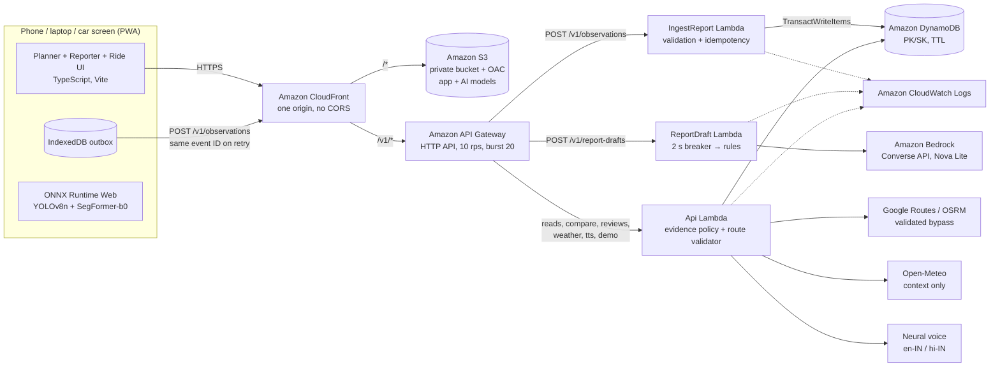
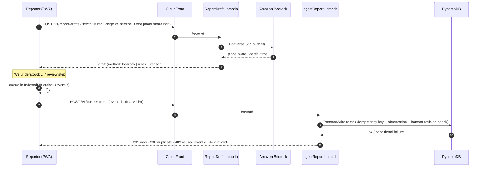
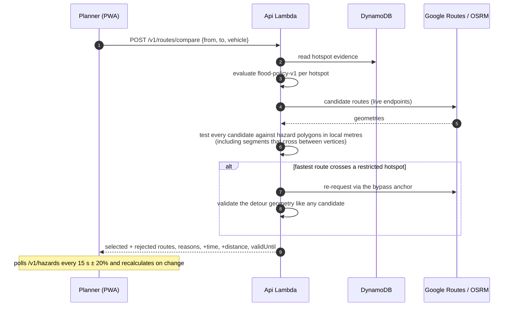
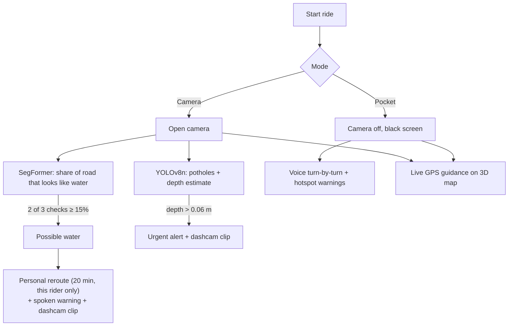

# DilliJalNav Edge

**Recent water reports. Better route decisions.**

Every monsoon, Delhi's underpasses flood within an hour, and navigation apps still send riders straight into them. Maps know traffic. They don't know water. DilliJalNav Edge checks your route against fresh waterlogging reports from people on the ground, avoids the flooded underpass, tells you exactly what the detour costs, and explains why.



**Live on AWS:** https://d3vchw4bg3abh4.cloudfront.net (`aws-demo` mode, synthetic reports)

**Theme:** Track 02, Heat and Water. Climate change is making Delhi's monsoon rain shorter, heavier and harder to predict, and the city's drains were not built for it. DilliJalNav Edge works on the water side of that problem. It focuses on the moment when climate turns into an everyday safety risk for millions of two-wheeler riders, auto drivers and commuters.

---

## Contents

- [Why this exists](#why-this-exists)
- [How it works in 30 seconds](#how-it-works-in-30-seconds)
- [Features](#features)
- [The evidence policy](#the-evidence-policy)
- [Architecture](#architecture)
- [How we use AWS](#how-we-use-aws)
- [Request flows](#request-flows)
- [On-device AI](#on-device-ai)
- [Run it locally](#run-it-locally)
- [Deploy to AWS](#deploy-to-aws)
- [Tests](#tests)
- [API](#api)
- [Configuration](#configuration)
- [Repository layout](#repository-layout)
- [Limits and roadmap](#limits-and-roadmap)

---

## Why this exists

Every year the same photo comes out of Delhi: a bus standing in brown water up to its windows under Minto Bridge, cars stuck behind it, a rider pushing a dead scooter out of knee-deep water.

That rider did not choose to drive into a flood. Their map sent them there. Mainstream navigation is excellent at traffic and has no idea about water. The people standing near the underpass *can see it is flooded*. That knowledge simply never reaches the rider two kilometres away.

DilliJalNav Edge closes that gap. It does that with three commitments:

1. **Get ground truth into the route.** Reports from people nearby change the route of people on the way.
2. **Never fake certainty.** Reports are claims, not measurements. The app shows the evidence and says what it does not know.
3. **Never quietly turn the road green again.** Old evidence keeps the underpass avoided until someone actually reports it clear.

## How it works in 30 seconds



The pilot corridor is **JLN Marg near Ajmeri Gate → Connaught Place**, with two real road-following candidates from OpenStreetMap and OSRM:

| Candidate | Path | Distance | Time |
|---|---|---|---|
| **A** | Through the Minto Bridge underpass | 1.7 km | ~3 min |
| **B** | Over Shivaji Flyover and Barakhamba Road | 3.2 km | ~4 min |

On a dry day the app suggests A and says plainly: *"No current waterlogging reports on the assessed segments."* Once water is reported and corroborated, A is marked **AVOIDED**, B is selected and the rider is told the cost: **+1 min, +1.5 km**.

## Features

### Planning
- **Map-first planner** that adapts to the screen: a bottom sheet on phones, a side panel on laptops, and a dark HUD with 54 px touch targets on car-size screens. The layout is chosen automatically.
- **First-run role picker:** two-wheeler rider, car or cab driver, auto driver, commuter, community reporter. It sets the vehicle and the wording of the advice.
- **Vehicle selector** (bike, auto, car, SUV, EV). It changes the explanation, but **no vehicle is ever cleared through reported water**.
- **Tap-anywhere routing** within 8 km of the pilot underpass. With a key it uses the **Google Routes API** (traffic-aware ETAs, real two-wheeler mode, up to 3 alternatives). Otherwise it uses public **OSRM**. If the fastest route crosses a restricted hotspot, the server re-requests via the hotspot's bypass anchor and **validates the detour geometry**. A waypoint alone never proves avoidance.
- **Why this route?** shows every source, its age, claimed depth and stalled vehicles, the policy rule and the known limits.
- **Weather context** from Open-Meteo, shown as context only. Rain never confirms or clears waterlogging.
- **Share trip** (Web Share with a WhatsApp fallback) and **SOS** (112, Delhi Traffic Police 1095, Delhi Jal Board 1916).

### Reporting
- **Structured choices:** water on the road, road blocked, no water seen, not sure. Plus an Ankle / Knee / Waist / Submerged depth claim and a stalled-vehicle count, always labelled as *claims*.
- **Hindi, English or Hinglish** by typing or speaking (browser speech recognition).
- **Amazon Bedrock drafting** turns free text into a structured draft. The reporter always sees *"We understood: …"* before anything is sent.
- **Durable IndexedDB outbox:** reports survive reloads and offline periods, are retried with the same event ID, and are sent single-flight so concurrent sends never duplicate a report.

### Riding
- **Start ride:** camera on top, flood-checked route below, turn guidance from live GPS, off-route warning, cue sheet of every maneuver, lane hints where OpenStreetMap has them.
- **Third-person ride map:** tilted 60° with 3D buildings, heading-up, with a rider avatar gliding between GPS fixes. It falls back to a flat follow camera without WebGL.
- **Two on-device AI models** (see [On-device AI](#on-device-ai)) for potholes and possible water ahead.
- **Camera-triggered personal reroute:** when the camera sees possible water, it reroutes *only that rider* for 20 minutes. It is never stored as evidence.
- **Speed-adaptive dashcam:** 2 fps stopped, 10 fps below 25 km/h, 20 fps cruising, 30 fps for 10 s around a hazard, with time, speed and position burned in.
- **Pocket mode:** camera never opened, black screen to save AMOLED battery, voice turn-by-turn and spoken warnings near flooded hotspots.
- **Natural bilingual voice:** neural en-IN and hi-IN voices via `GET /v1/tts`, prefetched at ride start. If audio is not ready within 1.2 s, the phone's built-in voice speaks instead, so a warning is never late.

### Honest by design
- Every screen shows its mode: `Demo · synthetic reports`, `AWS demo · synthetic reports`, `Pilot · community reports` or `Offline · last synced …`. There is no hidden fallback to mock data.
- If no candidate route is admissible, the app says so instead of drawing a reassuring line.
- Maps degrade gracefully. With no Google key, offline, or with a rejected key, the same drawing code runs on Leaflet + OpenStreetMap.

## The evidence policy

`flood-policy-v1` is a small set of transparent rules instead of a hidden confidence score. Each hotspot is always in exactly one state.



| State | Meaning | Underpass in routes? |
|---|---|---|
| `UNKNOWN` | No fresh evidence. **Not the same as dry.** | Allowed, with "no current reports" shown |
| `REPORTED` | One fresh positive source | Avoided |
| `CORROBORATED` | At least two distinct sources agree | Avoided |
| `CONFLICTED` | A newer "no water" report disagrees | Avoided until reviewed |
| `STALE` | Positive reports aged out (30 min), no accepted clear | **Still avoided** |
| `RECENTLY_CLEAR_REPORTED` | A reviewer accepted two newer "no water" reports from distinct sources | Allowed, labelled as not official |

Rules that make it trustworthy:
- **Each source counts once.** Contributor identities are HMAC-pseudonymised on the server.
- **Retries never become witnesses.** The same event ID with the same body returns the original result. The same event ID with a different body is rejected with `409`.
- **Freshness comes from `observedAt`**, never from when an upload arrived.
- **Writes are revision-guarded**, so two concurrent writers never overwrite each other.

## Architecture



**Design choices:**
- **One origin.** CloudFront serves the app from S3 and forwards `/v1/*` to the API. That removes every CORS problem and gives the HTTPS that the camera and GPS need.
- **Three functions, one codebase.** `handlers/api.py` routes by path. Separate functions give separate log groups and least-privilege IAM: only the draft function can call Bedrock, and it has no table permissions.
- **Pure domain core.** `backend/src/domain/` (policy, geometry, routes, validation, extraction) is standard-library Python with no AWS imports, so the same logic runs locally, in tests and on Lambda.
- **No VPC, NAT gateway or provisioned concurrency.** It scales to zero and costs almost nothing when idle.

## How we use AWS

| Service | What it does here | Why it matters |
|---|---|---|
| **Amazon CloudFront** | Serves the PWA and forwards `/v1/*` to the API from one domain. Managed caching for the app, caching disabled for the API. | One origin, HTTPS everywhere, no CORS, fast in India |
| **Amazon S3** | Private bucket for the app, the ONNX models and the WASM runtime. Readable only via **Origin Access Control**. | No public bucket |
| **Amazon API Gateway** (HTTP API) | REST endpoints with **throttling at 10 rps, burst 20**. | Protects the backend from abuse |
| **AWS Lambda** | Three Python 3.12 functions on **arm64 (Graviton)**: `IngestReportFunction`, `ReportDraftFunction`, `ApiFunction`. | Lower cost, isolated logs and permissions |
| **Amazon DynamoDB** | On-demand table with `PK/SK`. **TransactWriteItems** writes the observation, its idempotency key and the revision-guarded hotspot state together or not at all. **TTL** on `cleanupAt` enforces 7-day retention. | No lost or double-counted reports under concurrency |
| **Amazon Bedrock** | **Converse API** with **Amazon Nova Lite** (`apac.amazon.nova-lite-v1:0`) turns Hindi, English and Hinglish text into a structured draft (place, water or negation, time reference, claimed depth). | Natural reporting in the language people actually use |
| **AWS IAM** | One least-privilege role per function. The ingest role has table read/write only. The draft role has `bedrock:InvokeModel` only. | Small blast radius |
| **Amazon CloudWatch Logs** | A log group per function with 7-day retention. Every response carries a `requestId`. | Any report can be traced end to end |
| **AWS SAM + AWS CloudFormation** | `backend/template.yaml` defines the entire stack. `sam build` + `sam deploy` create it. `sam delete` removes it. | Reproducible infrastructure as code |

**Bedrock guardrails in code** (`backend/src/providers/bedrock.py`):
- **2 second circuit breaker.** If the model is slow or unavailable, the deterministic keyword extractor takes over, and the user never sees a `500`.
- **No invented places.** The extracted location must be on an allowlist of known Delhi sites **and** appear in the original text.
- **No invented depth.** Depth words must appear in the text.
- **Drafts never change state.** A draft is only a suggestion until the reporter reviews and submits it.

## Request flows

### Reporting water



### Choosing a route



### During a ride



## On-device AI

Both models run **in the browser with ONNX Runtime Web (WASM)**. No video ever leaves the phone.

| Model | File | Job | Output |
|---|---|---|---|
| **YOLOv8n** | `app/public/models/pothole-yolov8n.onnx` | Pothole detection | Boxes plus a depth estimate in metres from flat-road geometry and in-box darkness and smoothness (`app/src/potholeDepth.ts`). Tiers: < 0.03 m logged, 0.03 to 0.06 m warning, > 0.06 m urgent + clip |
| **SegFormer-b0** (ADE20K) | `app/public/models/water-segformer-b0-ade.onnx` | Per-pixel segmentation. Water, sea, river and lake classes count as water | Share of the road ahead that looks like water, about once a second. Two of three runs at ≥ 15% trigger "possible water" |

On real photos, 6 of 7 flooded streets read 17 to 94% water, and 6 dry Delhi roads read 0%. **Test a photo** in Settings runs both models on any image. The water model is not trained on Delhi monsoon footage, so the app says *"possible water"* and never files a report by itself. The depth estimate is a heuristic and is labelled *"est."*.

## Run it locally

No AWS account is needed. Python 3.12+ and Node 22+ are required (Node 24 is tested). The backend uses only the standard library.

**One command:**

```bash
python run.py
```

It installs what is missing, builds the app if the source changed, starts the server, opens an HTTPS Cloudflare tunnel and **prints a QR code**. Scan it with your phone and the app opens with the camera and GPS working. Press Ctrl+C to stop everything.

Options: `--no-tunnel` (LAN only, so the camera stays off without HTTPS), `--port N`, `--rebuild`.

**Manual steps:**

```bash
cd app && npm install && npm run build && cd ..
python backend/local_server.py        # http://127.0.0.1:8787  (APP_MODE=local-demo)
```

Open two windows at `http://127.0.0.1:8787`:
1. Window 1 suggests **Via Minto Road underpass** with "No current waterlogging reports".
2. In window 2, go to **Report conditions** → *Water on the road* → contributor **A** → Review → Submit. The state becomes `REPORTED`.
3. Submit again as contributor **B**. The state becomes `CORROBORATED`.
4. Within about 20 s, window 1 shows "New report received · Route recalculated" and suggests **Via Shivaji Flyover** (+1 min, +1.5 km).
5. Tap **Why this route?** to see each source, its age, the policy and the limits.

**Drive it from a terminal:**

```bash
python scripts/demo.py report a --text "Minto Bridge ke neeche paani hai"
python scripts/demo.py report b
python scripts/demo.py advance 35            # demo clock +35 min → STALE, still avoided
python scripts/demo.py fail on               # simulated provider failure → explicit 503
python scripts/demo.py report a --depth knee --stalled 3
python scripts/demo.py draft "Minto Bridge ke neeche 3 foot paani bhara hai"
python scripts/demo.py rain 12               # simulated, labelled rain; "rain off" clears
python scripts/demo.py reset
```

**Optional keys:** `VITE_GOOGLE_MAPS_KEY` in `app/.env.local` (Maps JavaScript API) and `GOOGLE_MAPS_API_KEY` in `.env` (Routes API). With no keys, the map is OpenStreetMap and routing is OSRM.

For UI work with hot reload, run `cd app && npm run dev`. Vite proxies `/v1` to the local server.

On Windows PowerShell 5.1, `&&` does not work, so run each command on its own line. If Application Control blocks the `.venv` interpreter, call the system Python directly.

## Deploy to AWS

You need the AWS CLI v2, the AWS SAM CLI, Docker (for the arm64 build) and an account with a budget alarm.

```bash
aws login --region ap-southeast-2            # browser sign-in, no access keys on disk

cd backend
sam build --use-container                    # builds Linux arm64 wheels
sam deploy --guided --stack-name dillijalnav-edge --region ap-southeast-2 \
  --capabilities CAPABILITY_IAM \
  --parameter-overrides DemoAdminKey=<16+ random chars> PseudonymSalt=<16+ random chars> \
    BuildId=$(git rev-parse --short HEAD) \
    BedrockModelId=apac.amazon.nova-lite-v1:0 \
    GoogleMapsApiKey=<optional Routes API key>
# outputs: AppUrl, ApiUrl, SiteBucketName, DistributionId, TableName, *FunctionName

cd ../app && npm run build
aws s3 sync dist s3://<SiteBucketName> --delete
aws cloudfront create-invalidation --distribution-id <DistributionId> --paths "/*"

DEMO_ADMIN_KEY=<same key> python ../scripts/demo.py --api <AppUrl> smoke
```

Notes:
- **Region:** use the Region your account or project lives in. A mismatch shows up as an expired sign-in in the browser.
- **Bedrock model:** use a model or inference profile that is enabled in your account and Region. New accounts may need verification to finish first. Leave it empty for rules-only drafting. Check `method: "bedrock"` in a `/v1/report-drafts` response.
- **Google Maps key:** if you restrict the browser key by HTTP referrer, add your CloudFront domain.
- **Teardown:** `aws s3 rm s3://<SiteBucketName> --recursive`, then `sam delete --stack-name dillijalnav-edge`. Confirm the stack name first.

`live-pilot` mode (real community reports) is implemented in the handler. It requires a JWT `sub` for writes and a `reviewers` group for reviews. The template ships `aws-demo` only, until the write routes have a Cognito JWT authorizer.

## Tests

| Command | What it proves | Result |
|---|---|---|
| `python -m unittest discover -s backend/tests -v` | 58 tests: evidence scenarios (E01 to E18, R01 to R10, S01 to S04), the handler, DynamoDB transaction shape and cancellation handling, Hinglish extraction (positive, negated, ambiguous), the Bedrock breaker (timeout, hallucinated place, invented depth), the dynamic bypass, depth and stalled claims, weather | 58/58 pass |
| `cd app && npm run check` | Camera alert engine, outbox retries / single-flight / sign-in hold, navigation core (position along route, next maneuver, hazard-segment clipping), water and depth heuristics | pass |
| `python scripts/demo.py --api <url> smoke` | Golden journey over HTTP: idempotency, `409`, corroboration, route switch, 6 concurrent writes, anonymous write rejected, stale, provider failure | **12/12 pass on the live AWS deployment** |
| `node scripts/e2e-browser.mjs C:/djn-e2e` | Real headless Chrome with a fake camera and fake GPS at 360 px: report → review → submit, corroboration, route switch, evidence drawer, XSS-safe text, Hindi, offline reload, offline queue, polling reroute, Hinglish auto-fill, ride with camera, Pocket mode, car layout | pass locally |

Mutation checks were also run. Breaking the corroboration threshold, the line/polygon test or the outbox single-flight makes the tests fail.

## API

| Endpoint | Auth | Purpose |
|---|---|---|
| `GET /v1/status` | public | Mode, policy version, capabilities, server time |
| `GET /v1/hotspots?corridorId=MINTO_CP` | public | Corridor metadata, presets, hotspot geometry |
| `GET /v1/hazards?corridorId=MINTO_CP` | public | Evaluated state per hotspot, with revision |
| `GET /v1/hotspots/{id}/evidence` | public, redacted | Source labels ("Source 1"), ages and policy reason. No identities |
| `POST /v1/observations` | demo contributor header (demo) or JWT (pilot) | Idempotent report. `201` new, `200` duplicate, `409` reused event ID or mode mismatch, `422` invalid, `429` rate limit |
| `POST /v1/routes/compare` | public | Route decision for a preset pair or tapped endpoints within 8 km. `avoid` adds a personal camera reroute. `vehicle` never relaxes restrictions |
| `POST /v1/report-drafts` | demo contributor header (demo) or JWT (pilot) | Text → draft (Bedrock or rules, with fallback reason). Never changes state |
| `GET /v1/geocode` | public | Place search for From/To |
| `GET /v1/weather` | public | Open-Meteo rainfall near the corridor plus an advisory flag. Context only |
| `GET /v1/tts?text=&lang=en\|hi` | public | Neural voice MP3 for alerts and turns |
| `POST /v1/reviews` | demo admin key (demo) or `reviewers` group (pilot) | Clear decision, with revision check |
| `POST /v1/demo/control` | demo admin key, demo only | Reset the demo namespace, demo clock offset, simulated provider failure |

Errors use the envelope `{"error": {"code", "message", "retryable", "requestId"}}`.

## Configuration

See [.env.example](.env.example). Secrets (`DEMO_ADMIN_KEY`, `PSEUDONYM_SALT`) exist only on the server, and the browser receives no credentials. Demo contributors are labelled synthetic, and the server forces their reports into the demo namespace with provenance `SYNTHETIC_DEMO`.

| Variable | Where | Purpose |
|---|---|---|
| `APP_MODE` | server | `local-demo` \| `aws-demo` \| `live-pilot` |
| `DEMO_ADMIN_KEY` | server | Demo reviewer actions and `/v1/demo/control` |
| `PSEUDONYM_SALT` | server | HMAC salt for contributor pseudonyms |
| `EVIDENCE_FRESHNESS_MINUTES` | server | Policy freshness window (default 30) |
| `HAZARD_POLL_SECONDS` | server | Client poll interval it is told to use (default 15) |
| `RETENTION_DAYS` | server | DynamoDB TTL for observations and idempotency rows (default 7) |
| `TABLE_NAME` | server (AWS) | Set = DynamoDB. Unset = in-process store |
| `BEDROCK_MODEL_ID` | server (AWS) | Bedrock model or inference profile. Empty = rules only |
| `GOOGLE_MAPS_API_KEY` | server | Optional Google Routes API. Empty = public OSRM |
| `VITE_API_BASE` | build | Empty = same origin (correct for CloudFront and the local server) |
| `VITE_GOOGLE_MAPS_KEY` | build | Optional Maps JavaScript API key. Empty = OpenStreetMap |

## Repository layout

```
app/                     Vite + TypeScript PWA (no framework)
  src/flood/             planner, report, evidence, API client, outbox, navigation core, EN/HI strings
  src/map/               Google Maps / Leaflet map view, markers, palette tint
  src/main.ts            screen wiring, ride screen, camera loop
  src/detector.ts        YOLOv8n pothole detector (ONNX Runtime Web)
  src/waterModel.ts      SegFormer water segmentation
  src/water.ts           water cue logic (2 of 3 at 15 %)
  src/potholeDepth.ts    depth estimate heuristic
  src/dashcam.ts         speed-adaptive recorder
  public/models/         ONNX models
  public/sw.js           service worker (offline shell)
backend/
  src/domain/            policy.py, geometry.py, routes.py, validation.py, extract.py (pure, stdlib)
  src/providers/         bedrock.py, external.py (routing, weather, geocode), tts.py
  src/storage/           local.py (in-process), dynamo.py (DynamoDB)
  src/service.py         operations, idempotency, revisions, auth mapping
  src/handlers/api.py    Lambda entry point
  src/data/              pilot corridor fixtures + DATA_SOURCES.md
  template.yaml          AWS SAM stack
  local_server.py        local server with the same contract
  tests/                 acceptance scenarios
scripts/                 demo.py, e2e-browser.mjs, fetch_corridor.py
assets/                  README images
ml/                      dataset config and training scripts for the next camera model
server/, android/        earlier pothole backend and TWA notes (legacy reference)
run.py                   one-command local run with HTTPS tunnel + QR code
```

## Limits and roadmap

**What it does not do:**
- It does not measure water depth. Depths are user claims.
- It does not certify that a road is safe. It shows evidence and says what it does not know.
- It has no live traffic colours, no search along the route, and no Apple CarPlay. "Car" is a responsive layout for large screens.

**Known limits:**
- **One corridor and one hotspot.** The geometry was retrieved by script and still needs human review (`backend/src/data/DATA_SOURCES.md`).
- **Reports are claims.** Source distinction is pseudonymous and approximate. Several accounts or coordinated false reports can still mislead it.
- **Camera estimates are heuristics.** The water cue and pothole depth are not validated on Delhi monsoon footage.

**Roadmap:**
- **More hotspots,** each with reviewed geometry and a validated bypass.
- **Amazon Cognito sign-in** and a JWT authorizer for `live-pilot` writes and reviewer roles.
- **A Delhi-trained camera model** for potholes, waterlogging, stalled vehicles and road blockages (`ml/hazards4.yaml`). Dataset licences must be checked before training.
- **Partners on the ground:** delivery fleets, auto unions and civic bodies who already know where water collects every year.

---

Map data © OpenStreetMap contributors (ODbL).
