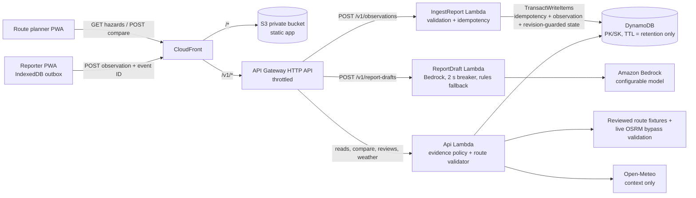

# DilliJalNav Edge

**Recent water reports. Better route decisions.**

DilliJalNav Edge helps a Delhi commuter decide whether to take their usual underpass route after local waterlogging reports. For one pilot corridor, it compares real road-following route candidates against recent community reports. If a route passes through a reported underpass, the app rejects it, shows the alternative and what it costs in time and distance, and explains why. When the evidence gets old, the app says it cannot confirm conditions. It never quietly turns the road green again.

Built for **Environmental Hacks (WeMakeDevs × AWS), Track 02: Heat and Water**. See [PROVENANCE.md](PROVENANCE.md) for what was inherited from the earlier PathFinder AR project and what was built during the event.

## What it does today

- **Pilot corridor:** JLN Marg near Ajmeri Gate → Connaught Place. There are two real candidates, retrieved from OpenStreetMap/OSRM:
  - **A**, through the Minto Bridge underpass: 1.7 km, about 3 min.
  - **B**, via Shivaji Flyover and Barakhamba Road: 3.2 km, about 4 min.
- **Structured reports:** water on the road, road blocked, no water seen, or not sure. Optional Hindi, English or Hinglish text, and a review step ("We understood: …") before anything is sent. Reports go into a durable IndexedDB outbox, so they survive reloads and offline periods. Retries reuse the same event ID.
- **Evidence policy `flood-policy-v1`:** transparent rules instead of a confidence score.

  | State | Meaning | Underpass in routes? |
  |---|---|---|
  | `UNKNOWN` | no fresh evidence; not the same as dry | allowed, with "no current reports" shown |
  | `REPORTED` | one fresh positive source | avoided |
  | `CORROBORATED` | at least two distinct sources agree | avoided |
  | `CONFLICTED` | a newer "no water" report disagrees | avoided until reviewed |
  | `STALE` | positive reports aged out (30 min) with no clear review | **still avoided** |
  | `RECENTLY_CLEAR_REPORTED` | a reviewer accepted two newer "no water" reports from distinct sources | allowed; labelled as not official |

  Each source counts once. Retries never become extra witnesses: the same event ID with a different body is rejected with `409`. Freshness comes from `observedAt`, never from when an upload arrived.
- **Route decision on the server:** geometry is tested in local metres, including a segment that crosses the hazard between two vertices. The response carries the selected and rejected routes, rejection reasons, extra time and distance, revisions and a `validUntil`. If no candidate is admissible, the app says so instead of drawing a reassuring line.
- **Explicit modes:** every screen shows `Demo · synthetic reports`, `AWS demo · synthetic reports`, `Pilot · community reports` or `Offline · last synced …`. There is no hidden fallback to mock data.
- **Map-first navigation UI** (`MAP_UI_SPECIFICATION.md`). It adapts to the screen:
  - **phone:** bottom sheet;
  - **laptop:** side panel;
  - **car-size screens** (wide and short): dark HUD with 54 px targets.

  The layout is picked automatically from the screen size; there is no toggle. The first run asks how you travel (two-wheeler rider, car/cab driver, auto driver, commuter, community reporter) and sets the vehicle from that.
- **Start ride (camera + route):** the original PathFinder camera loop is back as the main ride screen. The camera is on top, with on-device YOLOv8n pothole detection, alerts and the dashcam. The flood-checked route is below, with turn guidance from real GPS, an off-route warning, and a spoken warning near a hotspot with reported water. If the camera is denied, the ride continues map-only. The camera needs HTTPS (use the Cloudflare tunnel on a phone).

  It includes:
  - a blue arrow-and-puck pointer with a heading beam and a street-name tag;
  - a green guidance banner with a "Then …" chip, plus a tappable cue sheet of every maneuver from OSRM steps;
  - lane glyphs, shown only where OpenStreetMap has lane data;
  - a simulated drive, labelled as simulated;
  - a re-center pill with a 7 s countdown;
  - a cyan/red striped segment where a route crosses reported water.
- **Reroute notice:** "Minto Bridge underpass bypassed", showing the state, the number of sources, the report age, the claimed depth and any claimed stalled vehicles. The user can **Accept bypass (+n min)** or **Keep original route**; keeping it shows an explicit warning. When the route changes, a spoken caution plays in Hindi or English.
- **Vehicle selector** (bike / auto / car / SUV / EV): changes the advice wording. No vehicle is cleared through reported water. Depths are user claims, so an SUV does not get "direct transit".
- **Tap-anywhere routing** within 8 km of the pilot underpass, server-side. With `GOOGLE_MAPS_API_KEY` set it uses the **Google Routes API**: traffic-aware ETAs, real **two-wheeler mode** for riders, and up to 3 alternatives. With no key, or on any Google failure, it falls back to the public OSRM API. If the fastest route crosses a restricted hotspot, the server re-requests the route through the hotspot's bypass anchor (Shivaji Flyover / Barakhamba Road) as a via-waypoint. It then **validates the detour geometry** like any other candidate. A waypoint alone never proves avoidance. In Hindi, turn instructions come back in Hindi.
- **Google Maps** (`app/src/map/mapview.ts`): with `VITE_GOOGLE_MAPS_KEY` set, both maps use the Maps JavaScript API with palette-styled tiles (beige by day, a dark green HUD on the ride screen). With no key, offline, or if Google rejects the key, the same drawing code runs on Leaflet + OpenStreetMap.
- **Camera-triggered reroute:** when the camera's water cue fires during a ride, the app asks the server for a route around the water, starting from where the rider is now (`avoid` in `POST /v1/routes/compare`). If the water is inside a known basin, the whole basin is avoided (for example Minto Bridge, which switches to the Shivaji Flyover bypass). Elsewhere, only roads within 30 m of the water are avoided. The change is **only for that rider, for 20 minutes**, and is never stored as evidence: a heuristic must not reroute other people. The demo build has a "Demo: camera sees water at the underpass" button that shows this without real water.
- **Pothole depth estimate** (`app/src/potholeDepth.ts`), in **metres**: flat-road geometry gives the pothole's size on the ground. Darkness and smoothness inside the box, compared with the asphalt around it, give how sunken it looks. The result is "~0.12 m deep est." in three tiers: below 0.03 m is logged only, 0.03 to 0.06 m gets a warning, above 0.06 m gets an urgent alert and a saved dashcam clip. It is a heuristic and **not calibrated** against measured potholes; the overlay says "est.".
- **Third-person ride map:** during a ride the map tilts 60° (Google vector map with 3D buildings, tinted to the palette) and turns heading-up. A rider avatar seen from behind glides between GPS fixes. Heading comes from the GPS course while moving, otherwise the route direction, otherwise the compass. Without WebGL, the same follow camera runs on a flat map. If location is off or blocked, the ride screen says so and explains how to turn it on, instead of showing a frozen map.
- **Map tags:** a swirling **spiral** stands on every underpass with reported water (solid rim) and wherever the camera saw possible water (dashed rim). A floating **ping** marks every pothole the camera logged; it shows the estimated depth and stays on the phone for later rides. The camera view uses the same spiral and ping tags.
- **Two ride modes** (pill in the top bar):
  - **Camera:** the phone is on the handlebar; the camera is on and analysed as above.
  - **Pocket:** the camera is never opened and the screen is black (saves AMOLED battery). It gives voice turn-by-turn plus spoken warnings near hotspots with reported water. The browser still needs the screen on for GPS; a web app cannot track in the background.
- **Speed-adaptive dashcam** (`app/src/dashcam.ts`): frames are recorded at 2 fps when stopped, 10 fps below 25 km/h, 20 fps when cruising, and 30 fps for 10 s around a hazard. Time, speed and position are burned in. Footage stays in memory unless a clip is saved. Deep potholes and camera water save a clip automatically.
- **Bilingual voice:** ride alerts and turn-by-turn in English or Hindi (Devanagari for the voice; phonetic Hinglish kept in `i18n.ts` for review).
- **Hinglish report drafts** (`POST /v1/report-drafts`):
  - Amazon Bedrock extracts the place, water / negation, time reference and the claimed depth.
  - The model ID is configurable. A 2 s timeout acts as a circuit breaker, falling back to deterministic keyword rules, so the user never sees a 500.
  - Output is checked against an allowlist of 5 Delhi sites, and the place and depth words must actually appear in the text.
  - Voice input uses the browser's speech recognition where it is available.
  - The draft is always reviewed by the user ("We understood …") before anything is sent.
- **Depth and stalled-vehicle claims:** an Ankle / Knee / Waist / Submerged scale and a stalled-vehicle count. Both are shown as *claims*, never as measurements.
- **Weather context:** Open-Meteo model rainfall near the corridor, shown as a chip, with an advisory when heavy rain is forecast. Rain never confirms or clears waterlogging.
- **Share trip** (Web Share, falling back to WhatsApp) and **SOS** (112, Delhi Traffic Police 1095, Delhi Jal Board 1916; verify these locally).
- The camera runs **two models on the phone**:
  - **Potholes:** a YOLOv8n detector.
  - **Water:** a **SegFormer-b0 segmentation model** that labels every pixel. The water, sea, river and lake classes count as water. About once a second it measures how much of the road ahead is water. Two of three runs at 15 % or more trigger a warning, a dashcam clip and the personal reroute.
  - **Results on real photos:** 6 of 7 outdoor flooded streets read 17–94 % water, and 6 dry Delhi roads read 0 %.
  - **Test a photo** in Settings runs both models on any picture.

  The water model is not trained on Delhi monsoon footage, so the app says "possible water" and never files a report by itself (`app/src/water.ts`, `app/src/waterModel.ts`, checked by `app/src/water.check.ts`).
- **Natural voice:** alerts and turns are spoken by neural voices (en-IN, hi-IN) from the Python `edge-tts` library through `GET /v1/tts`. Phrases are prefetched when a ride starts. If the audio is not ready within 1.2 s, or the phone is offline, the phone's built-in voice speaks instead, so a warning is never late.
- **Route dock:** the planner panel is a bottom-left dock with smooth (squircle) corners on every screen size. It opens with the **Route** button and closes with **Hide**. **Camera ride** and **Report water** buttons float on the map.

What it does **not** do:
- measure water depth;
- certify that a road is safe;
- show live traffic colours;
- search along the route;
- integrate with Apple CarPlay. "Car" is a responsive layout for in-car or large screens, not a CarPlay app.

## Architecture



`backend/local_server.py` runs the same Lambda handler locally against an in-process store with the same contract. That proves the domain logic. It does not prove DynamoDB or IAM behaviour: for that, run `scripts/demo.py smoke` against the deployed URL.

## Run it locally (no AWS account needed)

**One command:**

```bash
python run.py
```

It installs what is missing, builds the app if the source changed, starts the server, opens an HTTPS Cloudflare tunnel and **prints a QR code in the terminal**. Scan the QR code with the phone camera and the app opens on the phone with the camera and GPS working. Press Ctrl+C to stop everything.
- Options: `--no-tunnel` (LAN link only; without HTTPS the phone camera stays off), `--port N`, `--rebuild`.
- Keys are optional: `VITE_GOOGLE_MAPS_KEY` in `app/.env.local` and `GOOGLE_MAPS_API_KEY` in `.env`. With no keys, the map is OpenStreetMap and routing is OSRM.

The manual steps below do the same thing.

You need Python 3.12 or newer, and Node 22 or newer (24 tested). The backend uses only the standard library.

```bash
cd app && npm install && npm run build && cd ..
python backend/local_server.py               # http://127.0.0.1:8787  (APP_MODE=local-demo)
```

Open `http://127.0.0.1:8787` in two browser windows, then:

1. In window 1, the planner suggests **Via Minto Road underpass** and shows "No current waterlogging reports on the assessed segments."
2. In window 2, go to **Report conditions** → *Water on the road* → contributor **A** → Review → Submit. The underpass becomes `REPORTED`.
3. Submit again as contributor **B**. The state becomes `CORROBORATED`.
4. Within about 20 s (poll every 15 s ± 20% jitter; 17.1 s measured locally), window 1 shows "New report received · Route recalculated", rejects A and suggests **Via Shivaji Flyover**: +1 min, +1.5 km.
5. Tap **Why this route?** to see each source, its age, the policy and the limits.

You can also drive the demo from a terminal:

```bash
python scripts/demo.py report a --text "Minto Bridge ke neeche paani hai"
python scripts/demo.py report b
python scripts/demo.py advance 35     # demo clock +35 min -> STALE, route still avoided
python scripts/demo.py fail on        # route provider failure -> explicit 503 state
python scripts/demo.py report a --depth knee --stalled 3   # claimed depth + stalled vehicles
python scripts/demo.py draft "Minto Bridge ke neeche 3 foot paani bhara hai"   # Hinglish -> draft
python scripts/demo.py rain 12        # SIMULATED rain (labelled) to show the weather advisory; "rain off" clears
python scripts/demo.py reset          # clears the demo namespace only
```

On Windows PowerShell 5.1, `&&` does not work. Run each command on its own line. If `python` is blocked by Application Control (the `.venv` interpreter), call the system interpreter directly, for example `& "C:\Users\<you>\AppData\Local\Programs\Python\Python312\python.exe" backend/local_server.py`.

For UI work with hot reload, run `cd app && npm run dev`. Vite proxies `/v1` to the local server.

## Tests

| Command | What it proves | Result on 2026-10-10 |
|---|---|---|
| `python -m unittest discover -s backend/tests -v` | 58 tests: brief section 16 scenarios (E01–E18, R01–R10, S01–S04), the handler, DynamoDB transaction shape and cancellation handling (fake client), Hinglish extraction (positive, negated, ambiguous, the brief's examples), the Bedrock breaker (timeout, hallucinated place, invented depth), the dynamic bypass with stubbed OSRM, depth and stalled claims, and weather | 58/58 pass |
| `cd app && npm run check` | Camera alert engine; outbox retries, single-flight, sign-in hold, invalid drop; navigation core (position along the route, next maneuver, hazard-segment clipping) | pass |
| `python scripts/demo.py smoke` (against a running server) | Golden journey over HTTP with request IDs: idempotency, `409`, corroboration, route switch, concurrent writes, anonymous write rejected, stale, provider failure | 12/12 pass locally |
| `node scripts/e2e-browser.mjs C:/djn-e2e` | Real headless Chrome at 360 px: no overflow, report → review → submit, corroboration, route switch, evidence drawer, XSS-safe text, Hindi, offline reload with a labelled saved route, offline queue delivered on reconnect, another client's reports rerouting a stopped page by polling, auto-fill from Hinglish, the reroute notice, the simulated-drive guidance, car layout with 54 px targets | 27/27 pass locally |

Mutation checks were also run: breaking the corroboration threshold, the line/polygon test or the outbox single-flight makes the tests fail. The smoke test has **not** yet been run against real AWS. Until it has, do not claim a working AWS deployment.

## Deploy to AWS (aws-demo mode)

You need the AWS CLI and SAM CLI, an account with a budget alarm, and a region of your choice.

```bash
cd backend
sam build
sam deploy --guided --stack-name dillijalnav-edge \
  --parameter-overrides DemoAdminKey=<16+ random chars> PseudonymSalt=<16+ random chars> BuildId=$(git rev-parse --short HEAD) \
  BedrockModelId=<a model or inference-profile ID enabled in your account+region, or leave empty for rules only>
# outputs: AppUrl, SiteBucketName, DistributionId, TableName, FunctionName

cd ../app && npm run build
aws s3 sync dist s3://<SiteBucketName> --delete
aws cloudfront create-invalidation --distribution-id <DistributionId> --paths "/*"

DEMO_ADMIN_KEY=<same key> python ../scripts/demo.py --api <AppUrl> smoke
```

The stack contains:
- CloudFront, serving the app from a private S3 bucket (Origin Access Control) and forwarding `/v1/*` to the API, so everything is on one origin with no CORS;
- an HTTP API throttled to 10 requests/s with bursts up to 20;
- one arm64 Lambda function with a table-scoped IAM policy;
- one on-demand DynamoDB table with TTL on `cleanupAt`;
- 7-day log retention.

No VPC, NAT gateway or provisioned concurrency is used. Check your account's current prices and credits before deploying. Budget alerts are not a spending cap.

**Teardown:** run `aws s3 rm s3://<SiteBucketName> --recursive`, then `sam delete --stack-name dillijalnav-edge`. Confirm the stack name first. Never delete resources you did not create with this stack.

`live-pilot` mode (real community reports) is implemented in the handler: it requires a JWT `sub`, and a `reviewers` group for reviews. The template does not ship it yet, because the write routes first need a Cognito JWT authorizer.

## Recording the demo (under 3 minutes)

The pitch can only claim what the build shows.

| Time | Show | Say |
|---|---|---|
| 0:00–0:20 | The planner, with the route through Minto underpass | "A Delhi rider has to decide whether the usual underpass is passable after monsoon rain. Maps don't know about this water; local reports do." |
| 0:20–1:00 | Report sheet: speak or type "Minto Bridge ke neeche 3 foot paani bhara hai", tap Auto-fill (show "Draft by Amazon Bedrock"), review, submit as A, then as B | "The report is a reviewed draft. Two separate contributors make it *corroborated*. Retries never count twice." |
| 1:00–1:30 | Second window: red striped hotspot, reroute notice, Accept bypass, Start drive with the spoken caution and the green guidance banner | "The server rejects the route through the reported underpass, validates the flyover detour, and says what it costs: +1 min." |
| 1:30–1:55 | `demo.py advance 35`: the state becomes STALE and the route is still avoided. Then `demo.py fail on`: an explicit failure | "Old reports don't turn the road green again, and failures are shown, never hidden." |
| 1:55–2:30 | AWS console: the DynamoDB item and its revision, CloudWatch logs for the IngestReport and ReportDraft functions with request IDs | "API Gateway, three Lambdas, DynamoDB transactions, Bedrock with a 2-second fallback." |
| 2:30–2:45 | Car layout, then the phone | "Same app on a phone or a car screen. Pilot: one underpass. Next: reviewed geometry for more hotspots." |

Avoid these claims. None of them is true of this build:
- the camera "detects water" or "measures pothole depth": it has a trained pothole detector plus two uncalibrated heuristics (possible-water cue, depth estimate);
- "Google Maps routes into floods" as a fact: it is unverified;
- "zero cost", "scales instantly", "prevents fake reports": deduplication limits duplicates, but it does not verify that reports are true;
- the water is "flooded" or "3 ft deep" as fact: say *reported*;
- rain "triggers" closures: rain is shown as context only;
- copyrighted news photos without permission.

## Configuration

See [.env.example](.env.example). Secrets (`DEMO_ADMIN_KEY`, `PSEUDONYM_SALT`) exist only on the server. The browser receives no credentials. Demo contributors are labelled synthetic, and the server forces their reports into the demo namespace with provenance `SYNTHETIC_DEMO`.

## API

| Endpoint | Auth | Purpose |
|---|---|---|
| `GET /v1/status` | public | mode, policy version, capabilities, server time |
| `GET /v1/hotspots?corridorId=MINTO_CP` | public | corridor metadata, presets, hotspot geometry |
| `GET /v1/hazards?corridorId=MINTO_CP` | public | evaluated state per hotspot, with revision |
| `GET /v1/hotspots/{id}/evidence` | public, redacted | source labels ("Source 1"), ages and policy reason; no identities |
| `POST /v1/observations` | demo contributor header (demo) or JWT (pilot) | idempotent report; `201` new, `200` duplicate, `409` reused event ID or mode mismatch, `422` invalid, `429` rate limit |
| `POST /v1/routes/compare` | public | route decision for a preset pair, or for tapped endpoints within 8 km (live OSRM + validated bypass); `vehicle` is echoed but never relaxes restrictions |
| `POST /v1/report-drafts` | demo contributor header (demo) or JWT (pilot) | Hinglish text to a draft (Bedrock or rules, with fallback reason); never changes state |
| `GET /v1/weather` | public | Open-Meteo model rainfall near the corridor and an advisory flag; context only |
| `POST /v1/reviews` | demo admin key (demo) or `reviewers` group (pilot) | clear decision, with revision check |
| `POST /v1/demo/control` | demo admin key, demo only | reset the demo namespace, demo clock offset, simulated provider failure |

Errors use the envelope `{"error": {"code", "message", "retryable", "requestId"}}`.

## Repository layout

```
app/                     Vite + TypeScript PWA (no framework)
  src/flood/             planner, report, evidence, API client, outbox, EN/HI strings
  src/main.ts            screen wiring + experimental camera (inherited)
  src/detector.ts, hazards.ts, dashcam.ts, alerts.ts, geo.ts   inherited camera stack
backend/
  src/domain/            policy.py, geometry.py, routes.py, validation.py (pure, stdlib)
  src/service.py         operations, idempotency, revisions, auth mapping
  src/handlers/api.py    Lambda entry point
  src/storage/           local.py (in-process), dynamo.py (DynamoDB)
  src/data/              pilot corridor fixtures + DATA_SOURCES.md
  template.yaml          SAM stack
  local_server.py        local demo server
  tests/                 acceptance scenarios
scripts/                 demo.py, e2e-browser.mjs, fetch_corridor.py
server/, ml/, android/   inherited pothole backend, training and TWA notes (legacy reference)
```

## Limits and next steps

- **One corridor and one hotspot.** The geometry is a candidate retrieved by script and is not yet human-reviewed (`backend/src/data/DATA_SOURCES.md`). The next step is a map review, then more hotspots that pass the same checks.
- **Reports are claims.** Source distinction is pseudonymous and approximate. Several accounts, or coordinated false reports, can still mislead the system. The app shows evidence; it does not verify it.
- **Routing:** the fixture corridor uses reviewed OSRM geometry; live routes use Google Routes (traffic-aware, two-wheeler) when a key is set, otherwise OSRM free-flow. No traffic colours are drawn.
- **Camera estimates are heuristics:** the water cue and pothole depth have not been validated on Delhi footage. `ml/hazards4.yaml` sets up the next model (pothole, waterlogging, stalled vehicle, road blockage) and lists candidate datasets; licences must be checked before training.
- **Not built yet:** Cognito sign-in for pilot writes, a water-segmentation model, live traffic, search along the route. Bedrock extraction is wired up but has not been tested against a real model: set `BedrockModelId` and check `method: "bedrock"` in a draft response.
- **The legacy pothole server test** (`server/test_server.py`) needs `httpx`, which is in `server/requirements.txt`.

Map data © OpenStreetMap contributors (ODbL).
